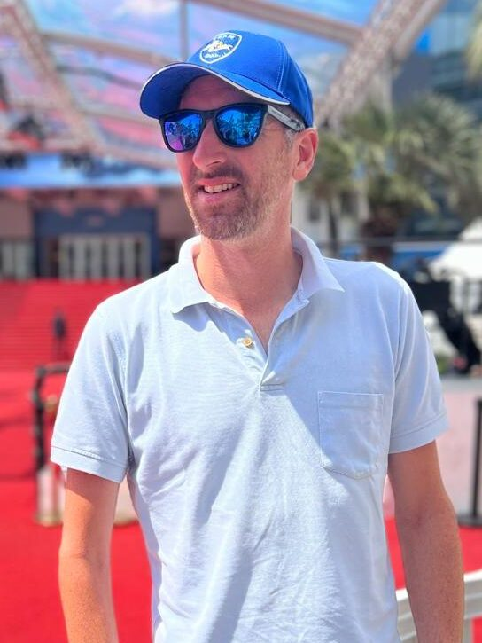

Email: [james@binbashtalent.com](mailto:james@binbashtalent.com)

I'm [James Irving-Swift](https://www.linkedin.com/in/jamesirvingswift/), enjoying my adventure that is life, thus far ending up in Andalucía, Spain. I've worked in a fair few software companies, varying sizes from a company of 3 people to FTSE and NASDAQ listed companies with thousands of employees!

I'm currently starting my own software developer recruiting agency called [#!/bin/bash talent](http://binbashtalent.com) and I feel like I have needed a space to write down my thoughts.

Software development has no been may only passion, when not coding or managing developers, I have been know to get involved in many other activities.

My intention of this page is not only to write my notes on software development, else on what stack I'm currently enjoying the most; but also about some of my other passions in life.

#### Sport

A daily tennis or padel player. A life hack here; find a sport you love and exercising is never a chore! Fancy a game, find me on playtomic!

Everything stands still for Arsenal matches and for the Formula 1!

#### Petrol head

Both new and classics... I love that sound of a cold start! And an exhaust that pops as you shift gear! Most years you can find me at the Goodwood revival. The cover photo in this page was from my drive from south of Spain to Ventimiglia in Italy.

#### Music

The Piano has always been my main instrument, as it was my first. But later on I picked up the guitar and most recently the bass! I play with a group on a regular basis in which we see which song we can butcher next!

A large reason I loved software development so much was because I loved getting in the zone with a fantastic album. My music taste is so varied, from Classical, Post-hardcore, Post-Rock, Metal, Electro, Pop, Pop-Punk, Emo, Funk and Disco, Ska, the list just keeps going. At the time of writing this, my last gig was Nils Frahm in Madrid, next gig should also be in Madrid, Touché Amoré.
