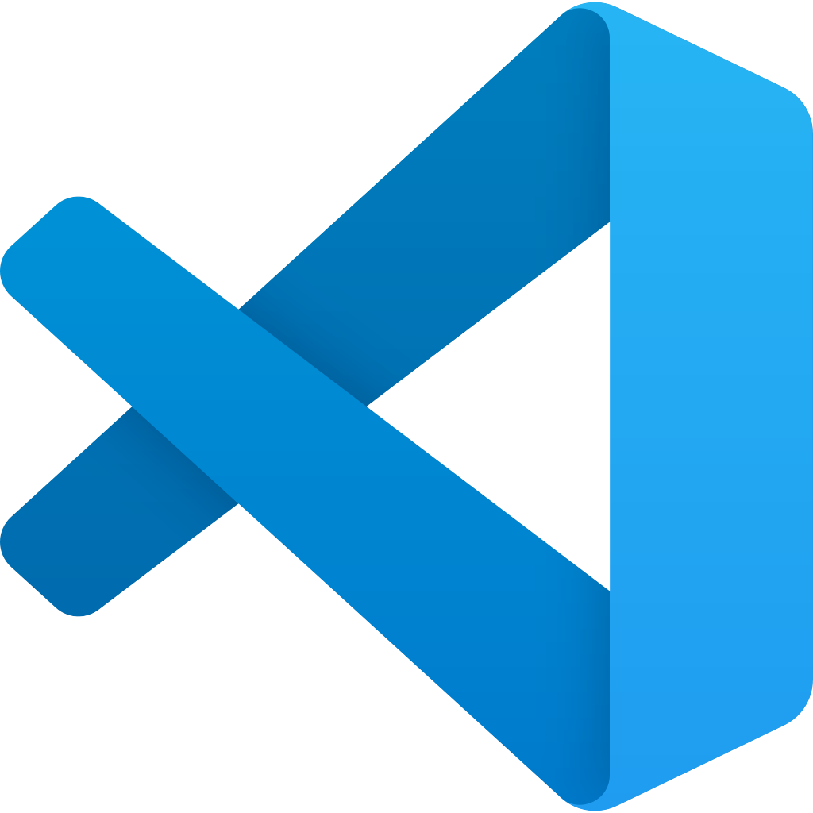
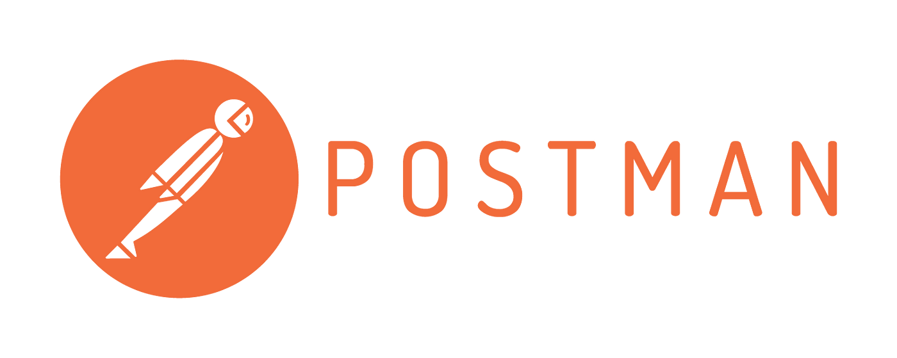

If you want to install all of these, please checkout the ansible script that I wrote about in [Setup your Mac with Ansible](/setup-your-mac-with-ansible/).

## 👨‍💻 Developer Tools

**DataGrip**

- **Why I Use It**: DataGrip by JetBrains is my go-to for managing databases. It works seamlessly with the database systems I use (like MySQL and PostgreSQL) and provides features like intelligent code completion and query formatting that make my work smoother. Before VSCode, I was drinking the jetbrains cool aid and I swore by all their products, now I only use DataGrip.

**Visual Studio Code (VS Code)**

- **Why I Use It**: VS Code fits perfectly into my workflow as a lightweight but powerful code editor. I’ve customized it with extensions that suit my preferences:
  - **GitLens**: Helps me keep track of Git histories and author information directly in the editor.
  - **Code Spell Checker**: Catches typos in my code, saving me from embarrassing mistakes.
  - **VSCode TODO+**: Keeps my task management streamlined by highlighting TODOs and FIXMEs in my codebase.

**Postman**

Old habits die hard, and honestly, I have not found a better tool to use for quick testing and debugging of RESTful API.

### 💻 Terminal Tools

**~~iTerm2~~**

- ~~**Why I Use It**: iTerm2 makes the command-line experience on macOS more efficient with features like split panes, tabs, and custom shortcuts. It’s an upgrade over the default macOS Terminal and fits my workflow perfectly. However, it may disappear completely soon in favour of warp.~~

**Ghostty**

- **Why it has replaced iTerm2 for me:** Because it is so fast 🚀🚀🚀! I'm still using Warp, and I expected to be using Warp more, however, due to the speed of Ghostty, this has become my go to terminal. If I'm stuck or debugging, I move to the more feature rich terminal that is Warp, however, for 95% of the tasks I do, I'm very happy with Ghostty.

**Warp**

- **Why It’s in My Setup**: Warp is a relatively new addition to my setup, and I love its modern approach to terminal use. The shared sessions and AI-powered auto-completion make it feel innovative and efficient. For me, this is probably the biggest game changer this year! If you want it, this is [my referral link](https://app.warp.dev/referral/MELL3R).

#### My Go-To Terminal Commands:

- **fzf (Fuzzy Finder)**: This tool makes navigating files and directories much faster.
- **tree**: A handy way to visualize directory structures at a glance.
- **ImageMagick**: A favorite for manipulating images directly from the command line.
- **mas**: Streamlines managing macOS App Store apps from the terminal.
- **dockutil**: Helps me keep my macOS Dock organized without manual adjustments.
- **asdf**: Keeps my programming language versions in check, which is a lifesaver when juggling different projects.
- **gh (GitHub CLI)**: Simplifies my interactions with GitHub repositories right from the terminal. To be honest, I mainly use it to authenticate with github as quickly as possible!
- **pnpm**: A faster and more efficient Node.js package manager that uses content-addressable storage to save disk space and enforce strict, predictable dependency resolution, avoiding issues like dependency hoisting. Its superior performance, better monorepo support, and enhanced developer experience make it a strong alternative to NPM and Yarn.
- **gitmoji**: I commit with `gitmoji -c` as it gives me prompts for my commits and allows me to have consistent emojis with my commits. Sound like a gimmick? I disagree, as my commit messages are clean and very easy to read/understand due to the emoji.

### Why Docker and Kubernetes Aren’t Here

You might notice that **Docker** and **Kubernetes**—two essential tools in modern development—are missing from this list. The reason is simple: I’m not currently working on any projects that require them. While they’re incredible tools for containerisation and orchestration, they’re not part of my setup at the moment. When the need arises, they’ll definitely make a return.

## 🌐 Browsers for My Workflow

**Brave Browser**

- **Why I Use It**: Brave is my default browser because it blocks ads and trackers by default, offering faster browsing. It’s simple and efficient, which aligns with my preferences.

**Arc Browser**

- **Why I’m Trying It**: Arc is a recent addition in early 2024 to my setup. Its innovative tab management and clean interface make it a fun browser to explore, especially for productivity-focused browsing.
- ⚠️ **Why I wouldn't recommend it:** As the browser company seem to be stopping to add features, I wouldn't recommend new users to get started with it though

## 📈 Productivity Tools

**Notion**

- **Why It Works for Me**: I use Notion for everything from task tracking to project planning. It’s highly customisable, which is perfect for keeping my workflows organised.

**Superhuman**

- **Why I’m Testing It**: I’m currently on the trial for Superhuman, and so far, I’m really enjoying it. The speed and minimalistic interface have been great for managing my inbox. My hope is to continue using it effectively enough to justify the hefty price tag. If you want to try it out, please use my [referral link](https://superhuman.com/refer/tnw03qfq) (gives me an extra free month!).

**WhatsApp**

- **Why I Keep It Handy**: WhatsApp is essential for both personal and professional communication. It’s reliable and easy to use, making it a no-brainer.

**ChatGPT**

- **Why It’s Always Open**: ChatGPT has become an indispensable tool for all of us! I prefer using the native app than using the web interface.

## 🛠️ Utilities

**MOS**

- **What is it?:** This is one of my favourite tools, it allows me to have 'natural' scrolling on my touchpad, however, conventional scrolling on a traditional mouse. On MacOS this is normally a global setting...very frustrating! <https://mos.caldis.me/>

**Raycast**

- Why I'm using it: Because it works like spotlight, however, there are loads of handy plugins that you can use with it, i.e. for Notion, Figma, Bitwarden, etc

## 👋 Tools I have moved away from in 2024

**Bitwarden**

- Apple Passwords seems to have 90% of the functionality and it integrated very nicely on my ecosystem, and, shockingly, works very well for me in Windows too! I really have like bitwarden, but for a free tier password manager, I'm happy to use the one that comes with my apple devices.

## Final Thoughts

This is my current developer setup—a collection of tools and technologies that match my workflow and the projects I’m working on. It’s not a one-size-fits-all solution, but it works for me. Whether it’s DataGrip for database management, VS Code with my favourite extensions, or Python and Node.js for coding, each tool has its place in my daily work.

What does your setup look like? Let me know in the comments—I’m always curious to learn about what works for other developers! Else, install all of this in one script, [Setup your Mac with Ansible](/setup-your-mac-with-ansible/).
