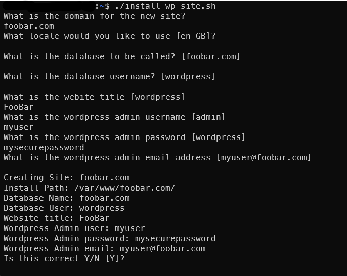

As a developer, laziness is key to my success! I don't want to repeat myself and therefore I want a one liner to do everything for me! Obviously, it is important to have an understanding of what that one-liner is doing!

When someone needs a new website and they want it set up on my server, I have a script for this. It is stored in my user's home directory and it is called `install_wp_site.sh`.

Prerequisites:

1. letsencrypt
2. apache2
3. wp-cli

Assumption is that your apache user is `www-data`

Please note: **Do not run as root**

```bash
#!/bin/bash

CURRENT_USER=$(whoami)

echo "What is the domain for the new site?"
read DOMAIN

if [ -z "${DOMAIN}" ]; then
        echo "Invalid Domain"
        exit 1
fi


INSTALL_PATH="/var/www/$DOMAIN/"

echo "What locale would you like to use [en_GB]?"
read LOCALE

if [ -z "${LOCALE}" ]; then
        LOCALE="en_GB"
fi

echo "What is the database to be called? [$DOMAIN]"
read DB_NAME

if [ -z "${DB_NAME}" ]; then
        DB_NAME="${DOMAIN}"
fi


echo "What is the database username? [wordpress]"
read DB_USER

if [ -z "${DB_USER}" ]; then
        DB_USER="wordpress"
fi


echo "What is the webite title [wordpress]"
read WP_TITLE

if [ -z "${WP_TITLE}" ]; then
        WP_TITLE="wordpress"
fi


echo "What is the wordpress admin username [admin]"
read WP_ADMIN_USER

if [ -z "${WP_ADMIN_USER}" ]; then
        WP_ADMIN_USER="admin"
fi

echo "What is the wordpress admin password [wordpress]"
read WP_ADMIN_PASS

if [ -z "${WP_ADMIN_PASS}" ]; then
        WP_ADMIN_PASS="wordpress"
fi


echo "What is the wordpress admin email address [${WP_ADMIN_USER}@${DOMAIN}]"
read WP_ADMIN_EMAIL

if [ -z "${WP_ADMIN_EMAIL}" ]; then
        WP_ADMIN_EMAIL="${WP_ADMIN_USER}@${DOMAIN}"
fi

echo "Creating Site: $DOMAIN"
echo "Install Path: $INSTALL_PATH"
echo "Database Name: $DB_NAME"
echo "Database User: $DB_USER"
echo "Website title: $WP_TITLE"
echo "Wordpress Admin user: $WP_ADMIN_USER"
echo "Wordpress Admin password: $WP_ADMIN_PASS"
echo "Wordpress Admin email: $WP_ADMIN_EMAIL"

echo "Is this correct Y/N [Y]?"
read CONFIRM

if [ -z "${CONFIRM}" ] || [ "$CONFIRM" = "Y" ] || [ "$CONFIRM" = "y" ]; then
        echo "OK"
else
        echo "Cancelling"
        exit 1
fi

sudo mkdir $INSTALL_PATH
sudo chown $CURRENT_USER:$CURRENT_USER $INSTALL_PATH

echo "Downloading Wordpress"
wp core download --path=$INSTALL_PATH --locale=$LOCALE

cd $INSTALL_PATH

echo "Generating config file"
wp config create --dbname=${DB_NAME} --dbuser=${DB_USER} --prompt=dbpass

echo "Creating Database"
wp db create

echo "Installing Wordpress"
wp core install --url=${DOMAIN} --title="${WP_TITLE}" --admin_user=${WP_ADMIN_USER} --admin_password=${WP_ADMIN_PASS} --admin_email=${WP_ADMIN_EMAIL}

cd /home/${CURRENT_USER}/
sudo chown -Rf www-data:www-data $INSTALL_PATH

echo "Creating Apache config"
cp 000-DOMAIN.conf 000-${DOMAIN}.conf
sed -i -e "s/DOMAIN/${DOMAIN}/g" 000-${DOMAIN}.conf
sudo mv ./000-${DOMAIN}.conf /etc/apache2/sites-available/000-${DOMAIN}.conf

echo "Enabling new apache configuration"
sudo a2ensite 000-${DOMAIN}.conf

echo "Restarting Apache"
sudo systemctl reload apache2

echo "Configuring SSL with LetsEncrypt"
sudo letsencrypt -d ${DOMAIN} -d www.${DOMAIN}

echo "Restarting Apache"
sudo systemctl reload apache2

echo "Completed setting up ${DOMAIN}"
```

In the same directory I have a apache configuration template called `000-DOMAIN.conf` it looks like this:

```apache
UseCanonicalName On

<VirtualHost *:80>
        ServerAdmin admin@DOMAIN

        ServerName DOMAIN
        ServerAlias www.DOMAIN

        DocumentRoot /var/www/DOMAIN

        <Directory /var/www/DOMAIN/>
            Options FollowSymLinks
            AllowOverride All
            Require all granted
        </Directory>

        ErrorLog ${APACHE_LOG_DIR}/error.log
        CustomLog ${APACHE_LOG_DIR}/access.log combined
        RewriteEngine on

        RewriteCond %{SERVER_NAME} =www.DOMAIN [OR]
        RewriteCond %{SERVER_NAME} =DOMAIN
        RewriteRule ^ https://%{SERVER_NAME}%{REQUEST_URI} [END,NE,R=permanent]
</VirtualHost>

<IfModule mod_ssl.c>
<VirtualHost *:443>
        ServerAdmin admin@DOMAIN

        ServerName DOMAIN
        ServerAlias www.DOMAIN

        DocumentRoot /var/www/DOMAIN

        <Directory /var/www/DOMAIN/>
            Options FollowSymLinks
            AllowOverride All
            Require all granted
        </Directory>

        ErrorLog ${APACHE_LOG_DIR}/error.log
        CustomLog ${APACHE_LOG_DIR}/access.log combined

        Include /etc/letsencrypt/options-ssl-apache.conf
        SSLCertificateFile /etc/letsencrypt/live/DOMAIN/fullchain.pem
        SSLCertificateKeyFile /etc/letsencrypt/live/DOMAIN/privkey.pem

</VirtualHost>
</IfModule>
```

What does it look like when you run it?



So what does this script do ?

It has a few steps:

1. It creates a new wordpress install in `/var/www/{your_domain}` and then sets up the database and creates an initial user.
2. Adds the apache config (80 and 443) in `/etc/apache2/sites-available` and enables it.
3. Runs certbot to sign a certificate for SSL.
