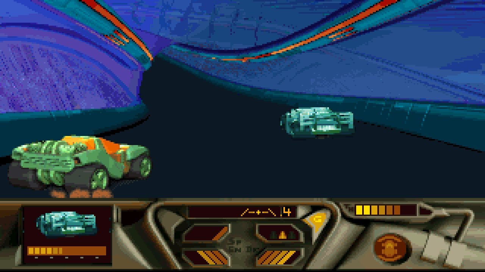
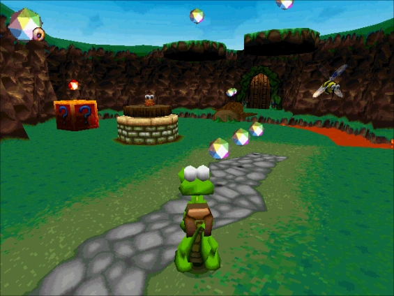
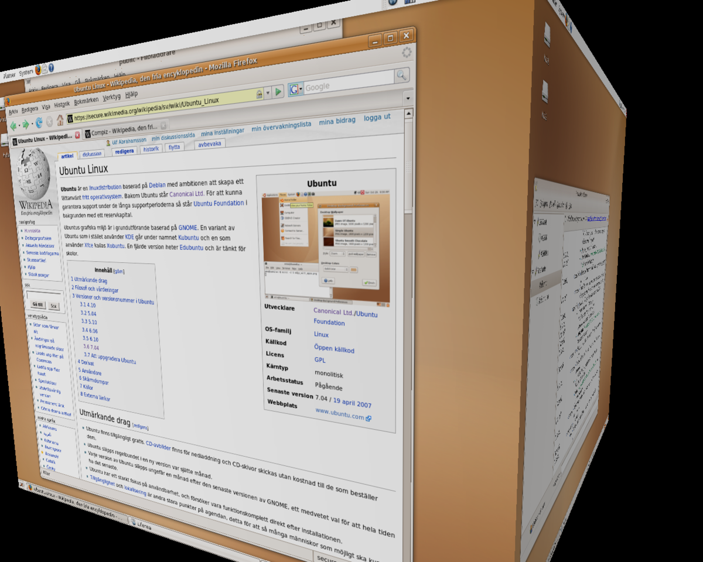
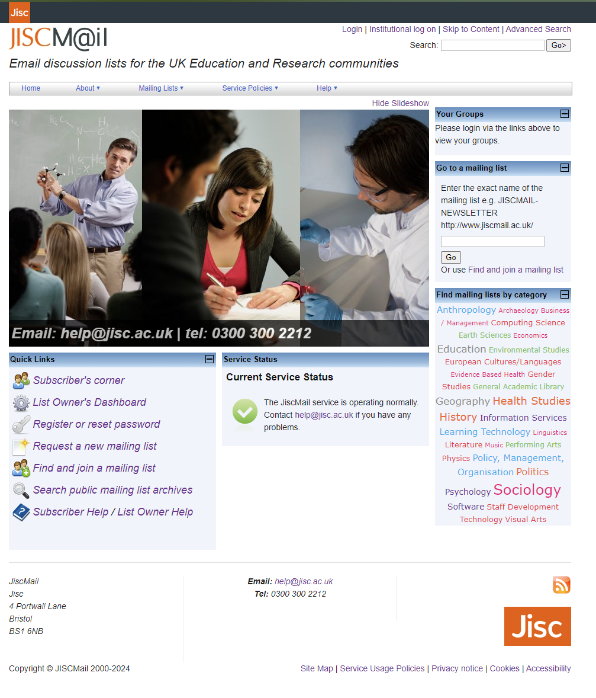
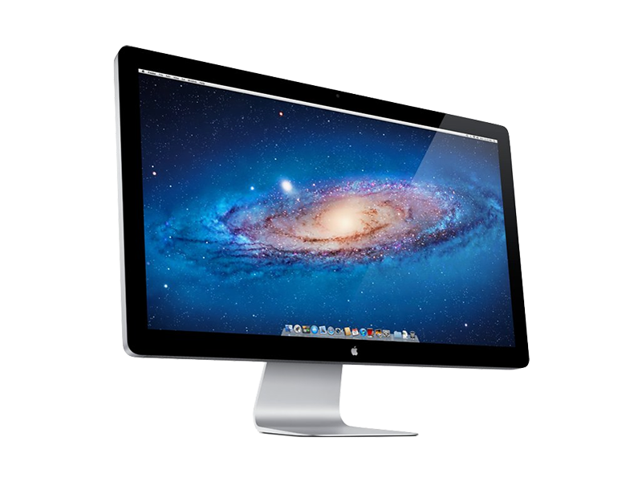
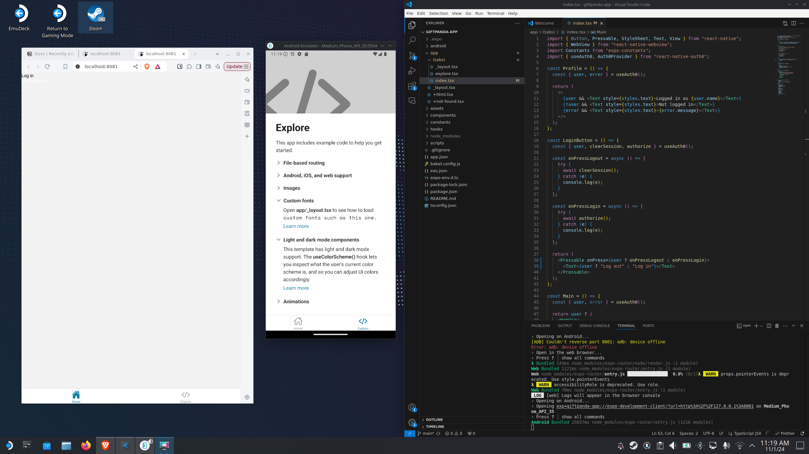

As most developers do, I'm often watching [Theo-t3.gg](https://www.youtube.com/@t3dotgg) and after watching his video [why he gave up on Linux](https://www.youtube.com/watch?v=c4DFgvUE1zM), I thought I would share my journey as I was surprised at how similar my journey was!

#### Early Days: Discovering Computers

My first computer experience was with an **Risc OS** on an **Acorn** at school, where I found joy in games like _Lemmings_ and _Dune II_. My friend’s Windows 3.1 introduced me to the now-'legendary' _MegaRace_. We did have BBC Micros at school, but we didn't really use them in anger.

<figure>

<figcaption>Mega Race Screenshot from https://www.youtube.com/watch?app=desktop&v=h2fMb1Cl72Q</figcaption>
</figure>

When our school upgraded to **Windows 95**, I was nine years old and amazed by games like _SimCity_ and _Theme Park_. At my next school, we used **Macs**, where I sent my first email with **Netscape Mail**, browsed the web with **Netscape Navigator**, and began dabbling in web design with **Netscape Composer**. Later, when that school switched to Windows 98, I explored _Colin McRae Rally_ and _Croc_ while using **FrontPage** for web design.

<figure>

<figcaption>Image source: https://croc.fandom.com/wiki/Croc:_Legend_of_the_Gobbos</figcaption>
</figure>

#### Teenage Years: The Shift to Linux and Networking

By age 15, I was a full-on Windows enthusiast, especially for gaming. **Counter-Strike LAN parties** led me to set up a network with a 10Mbps hub. I repurposed an old computer for **network-attached storage (NAS)**, but Windows was pricey. When I learned about **Red Hat Linux** and **Samba**, it marked my first steps into the **Linux** world.

At first, **KDE** seemed like a “budget Windows,” but the affordability made it appealing. Though I hadn’t mastered the terminal, I managed to navigate with a **KVM switch** to operate my Linux server – unaware of SSH!

#### University and Linux Exploration

Studying **Computer Science** in university introduced me to **Fedora** and **Ubuntu**, which I dual-booted with Windows XP. Working with **C and Unix**, I quickly realized how well Linux aligned with my studies. I became fascinated with Linux features like **Compiz effects** and **virtual desktops**.

<figure>

<figcaption>Compiz cube: Wikipedia: https://es.wikipedia.org/wiki/Archivo:Ubuntu_Feisty_Compiz_Cube.png</figcaption>
</figure>

With the release of **Windows Vista**, I ditched Windows for good and shifted fully to Linux, handling my gaming needs on **Xbox 360**.

#### Entering the Industry: Developing with Linux

My first industry job had me working on both **Windows Server 2003** and **CentOS** for educational and general markets, respectively. I proudly transitioned the team from **Dreamweaver** to **PHP**, solidifying my dedication to Linux. **Vim** (specifically **vimx**) became my preferred IDE, providing a deeper understanding of my code than IDEs like Eclipse and NetBeans could offer.

My first 'enterprise' website still stands. Of course I'm embarrassed about it, but we all start somewhere and I learnt so much. The worst use of jQuery you have probably ever seen and some pretty nasty PHP without a framework. Thankfully it is just a frontend for listserve so no risk of issues like SQL injections. I was so naïve!

Back then, I was still anti-Apple. My setup of **Linux on desktop, Blackberry Bold for mobile, and Xbox for gaming** was my ideal ecosystem, valuing simplicity and separation.

#### Trying Apple Products

Eventually, I joined **Tripadvisor** and was given a **MacBook with a Thunderbolt display and PHPStorm**. To my surprise, it was fast, seamless, and didn’t need constant driver updates. I fell for the MacBook, though I remained skeptical of Apple’s ecosystem. The **integration with Thunderbolt displays** and Linux-like features (like **virtual desktops** and **native SSH**) were ideal for development.

<figure>

<figcaption>I miss this display! Why won't apple make another? Source: https://lacapsula.es/rental/en/edition/monitors/apple-monitor-thunderbolt-display-27/27</figcaption>
</figure>

#### Evolving with Apple’s Ecosystem

Years later, I took the plunge and bought my first personal **MacBook Pro** in 2014. Working abroad, I found **AirPlay** on an Apple TV invaluable for accessing **Netflix** and other streaming services. My development was still on macOS, but I enjoyed the ease of iOS for mobile, especially with features like **iCloud integration** and a solid app ecosystem. Eventually, I also embraced the **Apple Watch** for fitness, appreciating how it integrated into my Apple ecosystem.

#### Return to Windows, but with a Twist

In 2019, I built a new gaming PC and revisited **Windows 10**, amazed by advancements like **native SSH** and **Windows Subsystem for Linux (WSL)**. I found myself using Windows more often for both work and gaming, while my MacBook took a backseat. Meanwhile, Apple’s **iPadOS with Sidecar** allowed dual screens on the go, which made it a valuable companion to my setup. For me iPadOS gave the iPad some identity and with a keyboard and pencil, the device at long last made sense to me.

On my last trip away, I didn't take my MacBook, instead I have my iPad Air and my Steamdeck! I did development on the steamdeck and email and other day to day tasks on the iPad. I thought I was done with Linux outside of WSL2, however, what Valve have done with Linux on the steam deck really deserves a standing ovation.

<figure>

<figcaption>Running expo with an Android simulator on SteamOS on the SteamDeck</figcaption>
</figure>

After years of experimenting, I now maintain a simple, functional setup that aligns with my professional needs and personal preferences. For development, I rely on **macOS on a new MacBook Pro** to take advantage of the Apple ecosystem’s productivity tools, from **universal clipboard** to seamless **AirPods switching**. For gaming and high-performance tasks, my **Windows PC** is reliable and versatile.

#### My opinion in my Journey from Acorn to macOS:

- **Windows**: Is fantastic now, even for development. WSL2 is really solid and other than a couple of port forwarding issues, it has been flawless. I would not have seen the point in running Linux natively, until I used the Steamdeck! If your main reason for a computer is to play games, Windows is the only realistic PC choice.
- **Linux**: If you have ever run Linux, you know how great it is 95% of the time, and you remember the 5% of the time that you spend having to fix it. Well, that 5% only gets more annoying! SteamOS is currently the only distro in which I use in a desktop format. For servers, I tend to use Ubuntu (server) or Debian.
- **MacOS**: It is great to be on a \*nix like operating system, with more reliability than more Linux distros. I don't miss the customisability of Linux as much as I thought I would. Yes, it is expensive, and yes, you can get trapped into the apple ecosystem... but there is no ecosystem like it at the moment. For me, the reason I won't budge from MacOS now is because of the following features:
  - Universal Clipboard
  - Sidecar
  - Handoff (for airpods)
