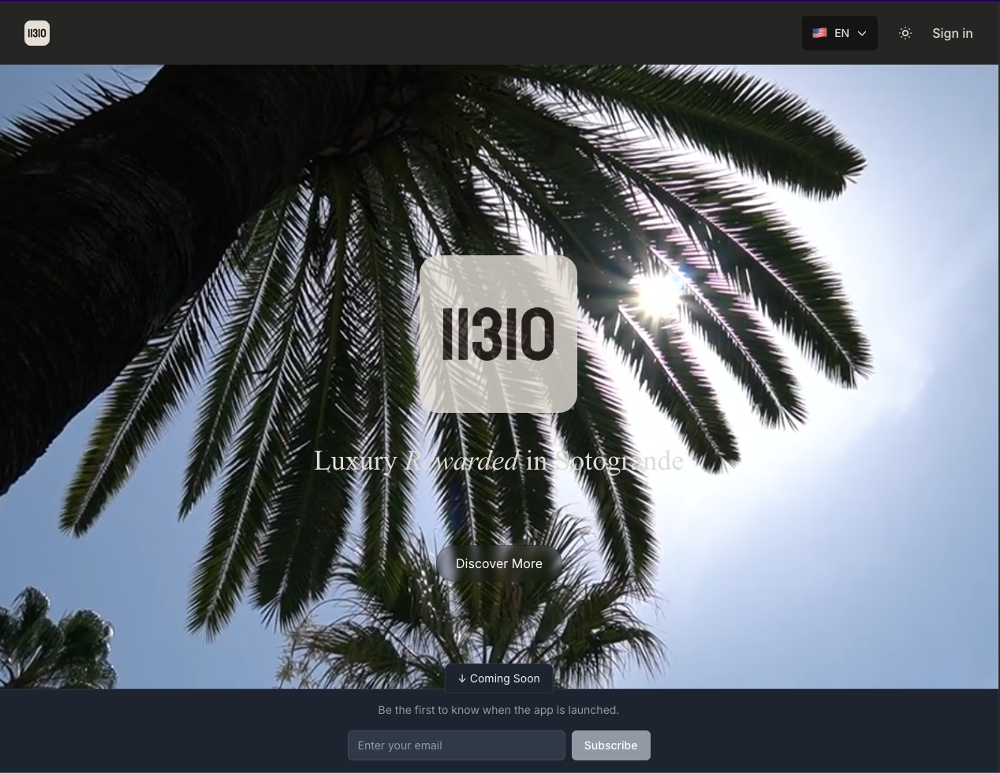
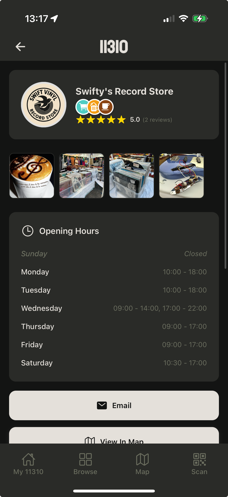
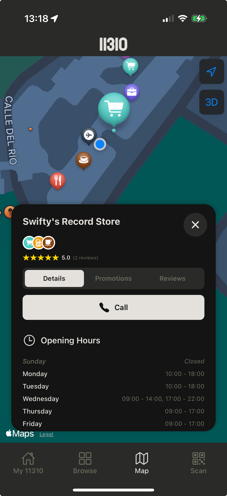
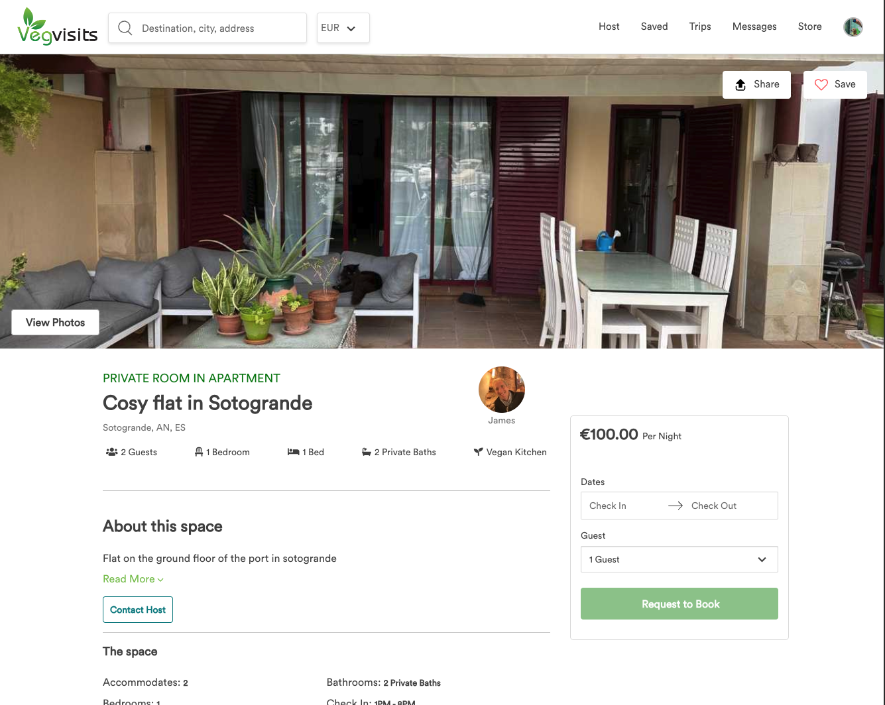

When I left Amenitiz last year, it wasn’t the smoothest of exits. After years of being fully embedded in high-growth startups, leading teams, and building products at pace, I suddenly had a chance to stop and reflect. What did I actually want next?

One thing was clear: I didn’t want to jump straight back into another employee role. Instead, I wanted to roll the dice and see what I could create for myself.

## **Why Recruitment?**

My first idea was to lean into **tech recruitment**. Over the course of my career, I’ve worked as Head of Software Development at Volume, Team Lead at Tripadvisor, and Tech Lead at Amenitiz. Across all those roles, I consistently saw the same problem: the quality of candidates being pushed through by recruiters was hit-and-miss at best.

Too often, recruitment is handled by people who have never written a line of code, yet they’re tasked with evaluating whether someone is a good fit for highly technical positions. It’s not that they don’t work hard, it’s simply that they lack the lived experience of being a developer. And when you don’t understand the role, you can’t filter candidates effectively.

That’s where I felt I could make a difference. As a recruiter with a developer’s background, I could bridge the gap: saving companies time by sending them candidates who had already been technically screened and truly understood.

I did manage to sign clients and continue to explore this route—it’s still something I believe in deeply—but in parallel, opportunities started to arrive in the form of **contracting and project work**.

And that’s where the last six months really took shape.

## **The Projects**

The common thread across most of my projects has been **mobile development with Expo**. Here are a few of the highlights:

### **CPOURNOUS.com**

CPOURNOUS already had a strong web presence, but they wanted to increase engagement and reach their audience more effectively on mobile. I helped them build and launch their app as a **webview client**, which meant their existing website could power the app experience while unlocking mobile-native features like push notifications.

It was a pragmatic approach that allowed them to move quickly without rebuilding everything from scratch. The app is now live on [Google Play](https://play.google.com/store/apps/details?id=com.cpournous.app&hl=en), and we’re just waiting on the submission process for iOS.

### **11310.com**

This was a blank-slate project, which is always exciting. The idea was to build a platform for the community of Sotogrande.

I designed the backend API in **Next.js** and the mobile app in **Expo**, creating both the infrastructure and the user-facing product. Building something from nothing is always challenging, but it’s also incredibly rewarding. And with 11310 being tied so closely to my own community, it’s a project that means a lot personally.

Check it out at [11310.com](https://www.11310.com)

### **VegVisits.com**

January brought a big development: I stepped into the role of **CTO at VegVisits**.

VegVisits is a platform for plant-based travel and accommodation, connecting people with retreats, hosts, and experiences that align with a vegan or plant-focused lifestyle. The mission resonates with me, and it’s been a great challenge to lead the technical vision of a platform with global ambitions.

Moving from short-term gigs into a leadership role like this has been energizing—it’s a chance to apply everything I’ve learned in startups, but also to help shape something that could have a meaningful impact on the way people travel.

### **Social Gaming Project**

Alongside all this, I’ve been quietly building a **social gaming project**. I can’t say too much just yet—it’s still in stealth mode—but I’ll be revealing details once it’s ready to launch. It’s been a fun, creative outlet for me, and I’m excited to share more soon.

## **Looking Back—and Ahead**

It’s been a busy and varied six months. What started as an experiment in independent recruitment has evolved into a blend of **recruitment, contracting, technical leadership, and product building**.

The biggest takeaway for me? Stepping off the familiar path of being an employee creates room for opportunities you might never have considered. It hasn’t always been smooth sailing, but I’ve grown more in these past months than I ever expected.

I don’t know exactly where the next six months will take me—but I do know that I’m excited to keep building, keep experimenting, and keep rolling the dice.
