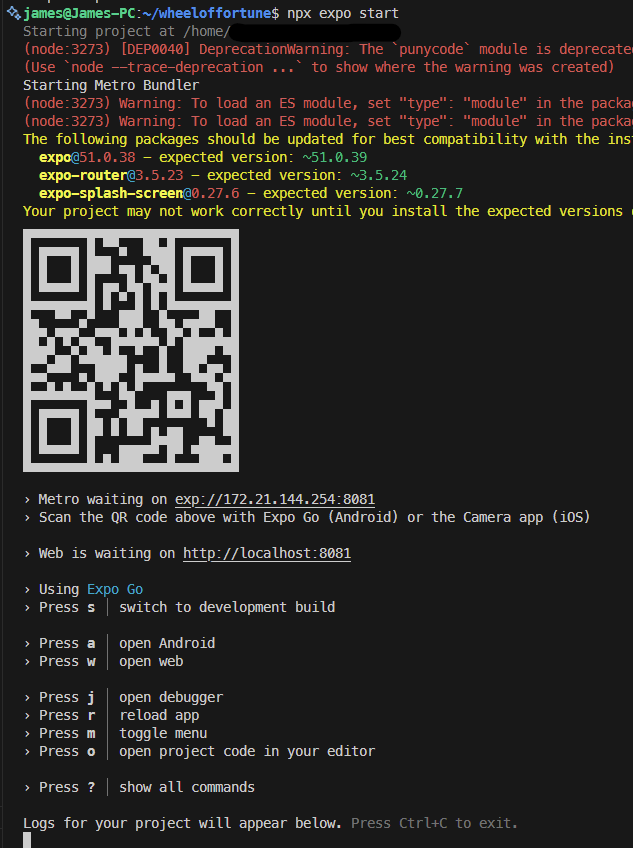
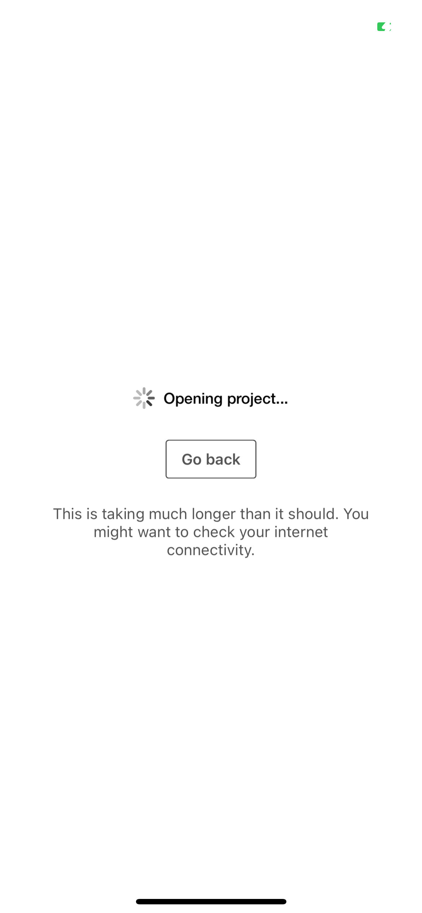
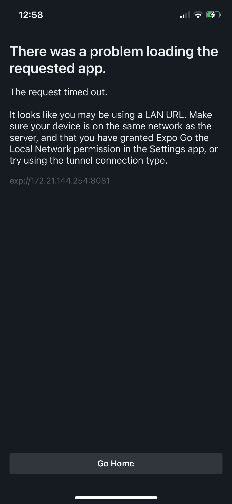
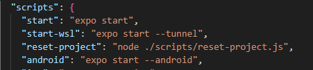

So you want to start a project in Expo, you are running Windows and WSL2, you follow the instructions and create you application like so:

```bash
$ npm install --global eas-cli
$ npx create-expo-app myExpoApp
$ cd myExpoApp
$ eas init --id your-id-here
```

Then as per the instructions on the `readme.md` you run:

```bash
$ npm install
$ npx expo start
```

And you are presented with the following screen:



Great! Let's scan the barcode and we should be up and running! But, No! You are presented with this:

<div class="image-row narrow">





</div>

This is my solution to get around this issue:

```bash
$ npx expo start --tunnel
```

But rather than entering this every time, I update my package.json with an entry for `start-wsl`



```bash
$ npm run-script start-wsl
```

If you are wondering why I don't just update `start` to include `--tunnel` it is because not everyone in my team is going to be using WSL2 and I don't want to annoy those on Windows without WSL2, nor those on linux or MacOS.
