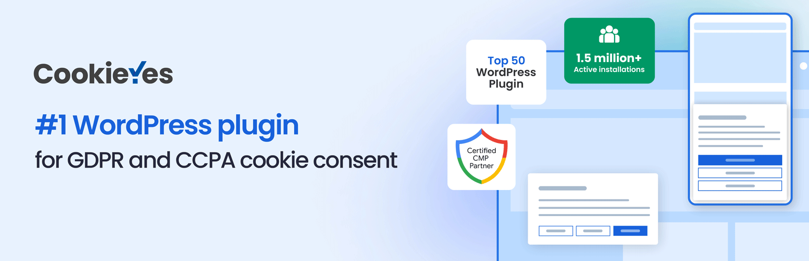
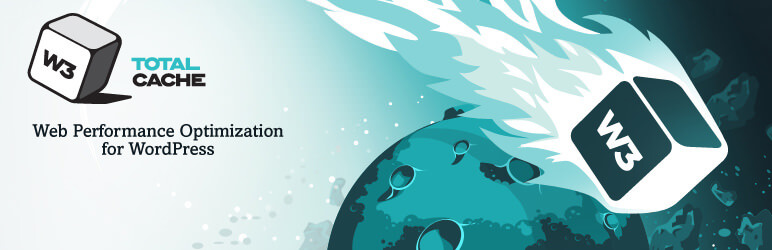
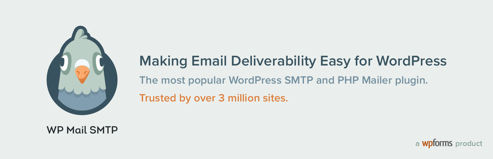

When it comes to running a smooth, secure, and optimized WordPress website, choosing the right plugins is crucial. Over time, I’ve refined my plugin choices to balance performance, security, and user experience. Out of personal preference, I like to keep things simple as it makes it easier to maintain. Here are the key plugins I rely on, with their pros and cons.

## 1. **CookieYes**

**Overview**: CookieYes helps ensure GDPR compliance by managing cookie consent effortlessly. It's a must-have if you want to stay on the right side of data protection regulations.

- **Pros**:
  - Easy setup with pre-made templates for GDPR, CCPA, and other privacy laws.
  - Customizable cookie consent banners.
  - Supports cookie scanning and automatic blocking of scripts until consent is obtained.
- **Cons**:
  - Can slow down your website slightly due to additional JavaScript.
  - Limited advanced features in the free version.

[Link to CookieYes Plugin](https://wordpress.org/plugins/cookie-law-info/)

## 2. **Jetpack (with Boost and Protect)**

**Overview**: Jetpack is an all-in-one solution for security, performance, and design. I use its Boost and Protect modules to enhance speed and safeguard my website.

- **Pros**:
  - Boost feature provides additional caching and lazy loading, improving speed.
  - Protect module includes a powerful firewall and downtime monitoring.
  - Regular updates from a 'trusted' developer (Automattic). I put trust in quotes due to the recent events from Automattic, but in the case of Jetpack, I feel that they are still to be trusted.
- **Cons**:
  - The interface can be overwhelming due to the number of features.
  - Some of the best features require a paid plan.

[Link to Jetpack Plugin](https://wordpress.org/plugins/jetpack/)

## 3. **W3 Total Cache (with Memcached on the server)**

**Overview**: W3 Total Cache is a highly recommended plugin for improving site speed. I pair it with Memcached for better performance.

- **Pros**:
  - Supports all major caching methods, including page, database, and object caching.
  - Works well with a Content Delivery Network (CDN).
  - Improved site performance with reduced load times when paired with Memcached.
- **Cons**:
  - Configuration can be complex for beginners.
  - Some features (like fragment caching) require upgrading to the pro version.

[Link to W3 Total Cache Plugin](https://wordpress.org/plugins/w3-total-cache/)

## 4. **WP fail2ban**

**Overview**: WP fail2ban adds an extra layer of security by logging WordPress login attempts to the system's fail2ban service, helping prevent brute-force attacks.

- **Pros**:
  - Provides server-level security that’s hard to bypass.
  - Works quietly in the background without adding a performance hit.
  - Effective against brute-force attacks.
- **Cons**:
  - Requires server-level access and understanding of fail2ban configurations.
  - No built-in dashboard for monitoring—logs are on the server.

[Link to WP fail2ban Plugin](https://wordpress.org/plugins/wp-fail2ban/)

## 5. **Yoast SEO**

**Overview**: Yoast SEO is the go-to plugin for optimizing content and improving visibility on search engines.

- **Pros**:
  - Comprehensive on-page SEO analysis and suggestions.
  - Provides tools for managing XML sitemaps, meta tags, and social sharing.
  - Regular updates to keep up with algorithm changes.
- **Cons**:
  - The free version lacks some advanced features.
  - The interface can feel cluttered for beginners.

[Link to Yoast SEO Plugin](https://wordpress.org/plugins/wordpress-seo/)

## For Contact Forms:

### 6. **Contact Form 7**

**Overview**: Contact Form 7 is a straightforward and customizable solution for creating forms on your WordPress site.

- **Pros**:
  - Free and simple to set up.
  - Highly customizable with HTML and CSS.
  - Supports various field types and CAPTCHA integrations.
- **Cons**:
  - Lacks an intuitive drag-and-drop interface.
  - Forms can look basic without additional CSS styling.

[Link to Contact Form 7 Plugin](https://wordpress.org/plugins/contact-form-7/)

### 7. **WP Mail SMTP (Configured with Twilio SendGrid)**

**Overview**: WP Mail SMTP ensures your WordPress emails are reliably delivered by using external SMTP services like Twilio SendGrid.

- **Pros**:
  - Fixes email delivery issues that are common with default WordPress settings.
  - Compatible with major SMTP services like SendGrid, Mailgun, and more.
  - Easy integration with Contact Form 7.
- **Cons**:
  - Requires an external SMTP account.
  - Some advanced configurations need manual setup.

[Link to WP Mail SMTP Plugin](https://wordpress.org/plugins/wp-mail-smtp/)

---

By optimizing your WordPress site with these plugins, you can cover a wide range of needs, from SEO and security to speed and compliance. Each plugin has its strengths and limitations, so choose the ones that align with your website’s goals.

Do you know of any plugins that I'm not using that I should be? Do you know of any better alternatives? Please let me know!
